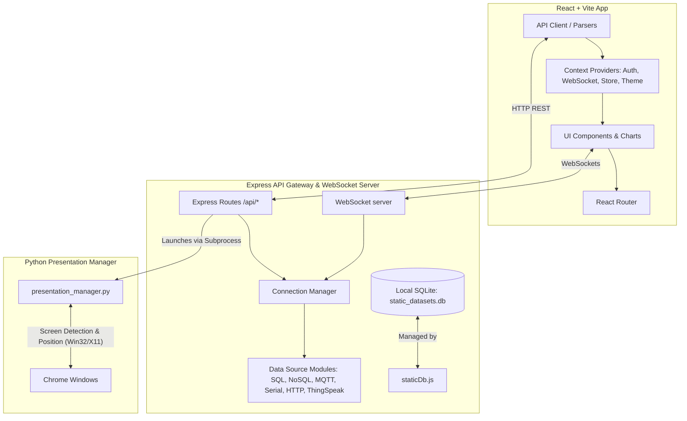

# Datanaut Project Analysis & Scaffolding

Datanaut is a full-stack data visualization platform that allows users to connect to live and static data sources, build interactive 2D/3D dashboards, and showcase them in real time using a Python-backed multi-screen presentation manager.

---

## 🏗️ Architecture & Component Relationships

Datanaut has two main components running side-by-side, plus a Python utility service for multi-display presentation management:



---

## 📂 Project Scaffolding (Key Folders & Files)

Here is a map of the directory structure and the purpose of each key file:

*   **`package.json`** — Frontend and project-wide runner configuration.
*   **`.env.example`** / **`.env`** — Frontend environment configurations (Firebase keys, backend URL overrides).
*   **`src/`**
    *   **`main.jsx`** — Application bootstrap file.
    *   **`App.jsx`** — Core router and visual layout shell (with sidebar, theme toggle, and chatbot).
    *   **`firebase.js`** — Initializes Firebase client configuration.
    *   **`pages/`**
        *   [`Login.jsx`](file:///c:/tansam-datanaut/datanaut-tansam/src/pages/Login.jsx) — Login interface with automated fallback to **Demo Mode** if Firebase is not configured.
        *   [`Data.jsx`](file:///c:/tansam-datanaut/datanaut-tansam/src/pages/Data.jsx) — Upload page for CSV, JSON, and XLSX.
        *   [`Visualize.jsx`](file:///c:/tansam-datanaut/datanaut-tansam/src/pages/Visualize.jsx) — Configurator to map file column fields to Recharts 2D/3D charts.
        *   [`Dashboard.jsx`](file:///c:/tansam-datanaut/datanaut-tansam/src/pages/Dashboard.jsx) — Dashboards displaying static visual charts.
        *   [`DynamicData.jsx`](file:///c:/tansam-datanaut/datanaut-tansam/src/pages/DynamicData.jsx) — Manage live connection targets (relational databases, NoSQL, MQTT streams, Serial, HTTP endpoints, ThingSpeak feeds).
        *   [`DynamicVisualize.jsx`](file:///c:/tansam-datanaut/datanaut-tansam/src/pages/DynamicVisualize.jsx) — Connects dynamic sources to visualizers.
        *   [`DynamicDashboard.jsx`](file:///c:/tansam-datanaut/datanaut-tansam/src/pages/DynamicDashboard.jsx) — Real-time stream dashboard update center.
    *   **`providers/`**
        *   [`AuthContext.jsx`](file:///c:/tansam-datanaut/datanaut-tansam/src/providers/AuthContext.jsx) — Simulated or real Firebase auth controller.
        *   [`WebSocketContext.jsx`](file:///c:/tansam-datanaut/datanaut-tansam/src/providers/WebSocketContext.jsx) — Socket hook for active chart streams.
        *   [`StoreContext.jsx`](file:///c:/tansam-datanaut/datanaut-tansam/src/providers/StoreContext.jsx) — In-memory app state and charts storage.
    *   **`backend/`**
        *   `package.json` — Backend-specific packages (Express, Mongoose, Mqtt, Serialport, SQLite3, ws).
        *   `server.js` — Core HTTP listener + WebSocket server bootstrap.
        *   `routes.js` — Exposes REST endpoints for connections, data operations, charts, and presentations.
        *   `connectionManager.js` — Spawns, pooling, and decrypts credentials for database/MQTT client instances.
        *   `presentation_manager.py` — Python tool that uses `ctypes` (on Windows) or `wmctrl` (on Linux) to handle screen geometry detection and multi-window positioning.
        *   `modules/` — Driver modules for SQL queries ([`sql.js`](file:///c:/tansam-datanaut/datanaut-tansam/src/backend/modules/sql.js)), static DB stores ([`staticDb.js`](file:///c:/tansam-datanaut/datanaut-tansam/src/backend/modules/staticDb.js)), serial, HTTP polling, etc.

---

## ⚡ How the App Runs (No Config Required for Dev Mode)

The project is designed to run out of the box with zero external configuration on `localhost`. 

If Firebase keys are not provided in `.env`, the frontend **gracefully degrades to Demo Mode**, allowing you to bypass auth checks, sign up/login with mock accounts, and visualize data without configuring Firebase or active databases.

Similarly, if `API_SECRET` and `ENCRYPTION_KEY` are not set in `src/backend/.env`, the backend runs in a non-authenticated local environment, storing credentials in plaintext for development convenience.

---

## ⚙️ Running the Project Locally

### 1. Verification & Diagnostics
We ran the backend test suites to verify system functionality. 
All 40 unit and integration tests are passing:
```bash
# Completed successfully
# pass 40
# fail 0
```

### 2. Command to Run Everything Together
To run the full stack simultaneously (both the Vite React frontend and the Express backend API), run this single unified command in the root folder:

```bash
npm start
```

This uses `concurrently` to spin up both systems:
*   **Vite Frontend Dev Server**: [http://localhost:5173](http://localhost:5173)
*   **Express Backend API & WebSockets**: [http://localhost:8085](http://localhost:8085)

### 3. Individual Execution Commands (Alternative)
If you prefer running the components in separate terminal windows, run the following:
*   **Frontend only**: `npm run dev` (run from the root directory)
*   **Backend only**: `npm run dev:backend` (run from the root directory)
